<!-- Cards are rendered by build.py and refreshed daily by .github/workflows/build.yml -->

  
  &nbsp;
  
  &nbsp;
  

Every card here is drawn by a small Python script and refreshed daily by GitHub Actions.

